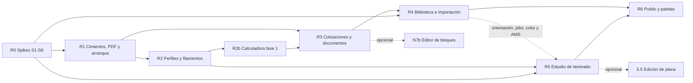

# 09 · Plan por fases y estimaciones

## 1. Supuestos y cómo leer las cifras

- **Unidad:** _jornada_ = 1 persona-día de ≈ 6 h efectivas de desarrollo. Incluye: implementación, pruebas (unitarias/integración, actualización de e2e), ajuste visual (claro/oscuro, móvil) y revisión de código. **No incluye:** QA manual del usuario, datos de producción, despliegue ni capacitación.
- **Tres cifras por paquete:** optimista / probable / pesimista. Son estimaciones de orden de magnitud (± 30 %) hechas **antes de los spikes**; R0 ya ejecutado (ver `spikes/`), se refinan tras los spikes S1–S5 (doc 04) y la validación de decisiones (README).
- **Contingencia:** no incluida; se sugiere **+15 %** sobre el total probable.
- **Línea base:** `development` @ `54a4bc6`. Las estimaciones descuentan lo ya construido (guarda de borrado, perfiles por boquilla, i18n, asesor de IA, ficha de desempeño) y **no incluyen** el trabajo ya especificado por otros documentos (calculadora v2, IA fases 2–4), que se estima aparte (§3.1).
- **i18n es/en:** el sitio es bilingüe y tiene pruebas de paridad; las cadenas de pantallas nuevas se cuentan en WP-6.4 (transversal), no dentro de cada WP.
- **Una sola persona desarrolladora**, sin asumir aceleración por asistentes de IA. El orden y las dependencias importan más que la fecha.
- **Alcance:** lo documentado en `02`–`08` más la segunda ronda de decisiones y requisitos (`10-decisiones-y-alcance-ampliado.md`, paquetes `N1`–`N10`, `R0` y `R2b`). Las decisiones D1–E3 ya están respondidas.

## 2. Paquetes de trabajo (WP)

### Fase 0 · Fundaciones y arreglos rápidos

| WP | Descripción | Hallazgos | Opt. | Prob. | Pes. |
|---|---|---|---:|---:|---:|
| 0.1 | `loading.tsx` / `error.tsx` / `not-found.tsx` y esqueletos por sección | UX-01 | 1 | 1,5 | 2 |
| 0.2 | Completar la guarda de borrado existente (`lib/slicer/usage.ts`): «reemplazar por…»/archivar y cubrir materiales, líneas de presupuesto y productos | PFC-05 (resuelto en parte), OM-03 | 0,5 | 0,75 | 1 |
| 0.3 | Filtros de compatibilidad en selectores (proceso/filamento por máquina) | PFC-03 | 1 | 1,25 | 1,5 |
| 0.4 | Aviso «orientación solo de prueba» y arreglos de copy (resultado, calculadora) | BIB-08, VIS-07, CLC-01 | 0,5 | 0,5 | 1 |
| 0.5 | Salud del sistema (Orca/Chromium/ffmpeg), fallo explícito del PDF, `playwright` a `dependencies`, Dockerfile sin `\|\| true` | PDF-01/02, TEC-03, OM-01 | 1 | 1,25 | 1,5 |
| 0.6 | Iconografía unificada con `lucide-react` | UX-05 | 1 | 1,5 | 2 |
| 0.7 | Campo de fecha es-CL | UX-06 | 0,5 | 0,75 | 1 |
| | **Subtotal F0** | | **5,5** | **7,5** | **10** |

### Fase 1 · Desacople de perfiles, filamentos y calidad (doc 02)

| WP | Descripción | Opt. | Prob. | Pes. |
|---|---|---:|---:|---:|
| 1.1 | Modelo de datos (`ProfileRef`, `quality_presets`, `inputs` en corridas; **sin** vínculo material→perfil, D1), migración «expandir», script de backfill | 4 | 5 | 6 |
| 1.2 | Resolvedor (`resolveSliceInputs`) y refactor de `setup.ts`, `queue.ts`, `actions/slicer.ts`, `context.ts`; **preferencia de usuario «última elección de filamento» en la base de datos** (`user_prefs`, F10) | 2,5 | 3 | 4 |
| 1.3 | UI de Calidad (presets, selector, edición) | 2 | 2,5 | 3 |
| 1.4 | «Mis perfiles»: lista unificada, diff vs. fábrica, copy-on-write, uso accionable; unificar importación | 2 | 2,5 | 3 |
| 1.5 | Simplificar «Configurar laminado» → «Impresoras» | 1 | 1,25 | 1,5 |
| 1.6 | Pruebas (resolvedor, backfill, integración, e2e 02/03/12) | 2 | 2,5 | 3 |
| | **Subtotal F1** | **13,5** | **16,75** | **20,5** |

### Fase 2 · Biblioteca de modelos 3D (doc 03)

| WP | Descripción | Opt. | Prob. | Pes. |
|---|---|---:|---:|---:|
| 2.1 | Importación: cola `jobs`, hash previo y decisión de duplicados, multi-subida, ZIP/carpeta, metadatos por lote, 3MF multi-objeto | 3 | 4 | 5 |
| 2.2 | Listado: filtros en URL, paginación por cursor, etiquetas/carpetas normalizadas, selección múltiple y acciones masivas, vista lista | 3 | 4 | 5 |
| 2.3 | Miniaturas turntable e insignias («cabe», «N laminados», «usado en…») | 2 | 2,5 | 3 |
| 2.4 | Detalle unificado (pestañas sin recarga, «¿Cabe?» real, versiones comparables, orientación persistente) | 2 | 2,5 | 3 |
| 2.5 | Procesamiento persistente y reanudable (sobre `jobs`) | 1 | 1,5 | 2 |
| | **Subtotal F2** | **11** | **14,5** | **18** |

### Fase 3 · Cotizaciones y PDF (doc 05)

| WP | Descripción | Opt. | Prob. | Pes. |
|---|---|---:|---:|---:|
| 3.1 | Listado: KPIs, segmentos, fila rica, tablero opcional | 2 | 2,5 | 3 |
| 3.2 | Detalle: stepper, pestañas, líneas ricas, costos en capas, versiones con diff, actividad | 4 | 5 | 6 |
| 3.3 | Editor: Editar/Vista cliente/dividida, panel de totales, simplificación del precio, `LineEditor` modular, typeahead | 3 | 4 | 5 |
| 3.4 | **PDF v2:** `<QuoteDocument>` único, diseño, navegador persistente, snapshot almacenado, opciones | 4 | 5 | 6 |
| 3.5 | Pruebas (PDF golden, paginación, permisos, e2e 03/06/07/08) | 1,5 | 2 | 2,5 |
| | **Subtotal F3** | **14,5** | **18,5** | **22,5** |

### Fase 4 · Calculadora y mantenedores (doc 06)

| WP | Descripción | Opt. | Prob. | Pes. |
|---|---|---:|---:|---:|
| 4.1 | Complementos visuales de la calculadora v2: `LayerBar`, selectores ricos, «Ajustar en el Estudio», chips «¿Y si…?», miniaturas (el resto está en `docs/spec-calculadora.md`, ver §3.1) | 2 | 2,5 | 3 |
| 4.2' | Mantenedor de filamentos v2: **líneas de marca con colores como hijos desde el inicio (D14)**, tarjetas/carretes, panel lateral, fuente única densidad/costo, migración con vista previa | 5 | 6,5 | 8 |
| 4.3 | Ficha de máquina: pestaña «Laminado» y estado | 1 | 1 | 2 |
| | **Subtotal F4** | **8** | **10** | **13** |

### Fase 5 · Estudio de laminado (doc 04) — nivel A (D7); spikes en R0

| WP | Descripción | Opt. | Prob. | Pes. |
|---|---|---:|---:|---:|
| 5.1 | Núcleo: layout, esquema ≈120 parámetros + fallback, ajustes de sesión, re-laminado con debounce/cancelación, KPIs con deltas, «guardar como perfil», orientación aplicada vía 3MF | 10,5 | 13 | 16 |
| 5.2 | Visor de G-code v2 (tipos reales, modos de color, leyenda con tiempos, sin muestreo, A/B) | 6 | 7,5 | 9 |
| 5.3 | Exploración (barridos, rejilla, gráfico tiempo–gramos–precio, Pareto) reemplazando el Comparador | 4 | 5 | 6 |
| 5.4 | Worker aislado, prioridades, cancelación, SSE | 3 | 3,5 | 4 |
| | **Subtotal F5 (núcleo)** | **23,5** | **29** | **35** |
| 5.5 | _Opcional:_ edición de placa (multiobjeto, gizmos, ordenar/orientar, cama real, ajustes por objeto) | 10 | 12,5 | 15 |

### Fase 6 · Sistema visual transversal (doc 07)

| WP | Descripción | Opt. | Prob. | Pes. |
|---|---|---:|---:|---:|
| 6.1' | **Adopción de librería de componentes** (recomendada: shadcn/ui, a confirmar con S8) + kit base (Select rico, Tabs cliente, Drawer, Segmented, DataTable, Stat/Delta, LayerBar, Spool, Skeleton/Empty, Toast con acción, `Kbd`/paleta de acciones, `ViewToggle`) + **arquitectura de temas** (tokens en 3 capas, Tailwind sobre variables) + contrato responsivo y matriz de pruebas | 8 | 10 | 13 |
| 6.2 | Barrido en pantallas restantes (clientes, pedidos, cola, máquinas, ventas, galería, reportes, configuración) | 6 | 7,5 | 9 |
| 6.3 | Regresión visual automática, a11y y móvil | 2 | 2,5 | 3 |
| 6.4 | **Transversal:** textos es/en de todas las pantallas nuevas y prueba de paridad (se reparte entre R1–R6) | 6 | 7,5 | 9 |
| | **Subtotal F6** | **22** | **27,5** | **34** |

### Segunda ronda · Requisitos nuevos y spikes (doc 10)

| WP | Descripción | Opt. | Prob. | Pes. |
|---|---|---:|---:|---:|
| **R0** | **Spikes:** S1–S5 (flags de CLI, esquema de parámetros, tiempos, 3MF construido, parser de G-code) 3,5 / 4 / 4 · S6 MakerWorld con token real 1,5 / 2 / 3 · S7 3MF multicolor/AMS 0,5 / 1 / 1,5 · S8 librería visual (piloto comparativo) 2 / 2,5 / 3,5 | 7,5 | 9,5 | 12 |
| **R2b** | Fase 1 de `docs/spec-calculadora.md` (cálculo neto, IVA opcional, margen sobre neto, redondeo único, perfil Heredado) — decisión E2 | 4 | 5 | 7 |
| N1a | Color del material en el visor 3D | 1 | 1,5 | 2 |
| N1b | Multicolor/AMS en 3MF: paleta de ranuras, pintura por triángulo, asignación a inventario, laminado multifilamento | 5,5 | 7 | 9 |
| N2 | Etiquetado automático con IA al subir (con respaldo determinista) | 4 | 5 | 7 |
| N3a | Importador MakerWorld (rutas A y B), esquema `model_sources`, galería, licencias | 6 | 8 | 11 |
| N3b | Importador genérico (OpenGraph) para otros sitios | 2 | 3 | 4 |
| N4 | Alta masiva de filamentos y stock (+ catálogo inicial de marcas/colores **incluidas marcas de Chile**) | 6 | 8 | 10,5 |
| N4b | **Directorio de proveedores** (tabla, carga inicial desde `datos/proveedores-iniciales.json`, selector en entrada de compra y alta masiva, pantalla en Configuración) — doc 11 | 2,5 | 3,5 | 5 |
| N5a | Fila desplegable + «Ver detalles» (modal y página, ruta interceptada) | 3 | 4 | 5,5 |
| N5b | Anexo de detalles opcional en el PDF | 1,5 | 2 | 3 |
| N6 | Vista tabla (listado y líneas editables) con preferencia recordada en el navegador | 4 | 5,5 | 7,5 |
| N7a | **Editor de plantillas de documentos en Configuración** (nivel L1: logo, colores, secciones, textos, vista previa; **sin** edición por cotización, F3) | 6 | 8 | 10,5 |
| N9b | Catálogo de paletas, selector con preferencia de usuario en `localStorage` (script anti-parpadeo), derivación desde la marca y pruebas de contraste | 3 | 4,5 | 6,5 |
| N10 | Asistente de configuración inicial (primer arranque, token de configuración, 15 pasos) | 10 | 13,5 | 17,5 |
| | **Subtotal segunda ronda** | **66** | **88** | **118** |

_Opcionales posteriores (fuera de totales):_ N7b editor de bloques L2 **16 / 21 / 27** · widgets configurables de Inicio **6 / 8 / 11** · 5.5 edición de placa **10 / 12,5 / 15**.

## 3. Totales

| Alcance | Optimista | **Probable** | Pesimista | Probable +15 % |
|---|---:|---:|---:|---:|
| Primera ronda (F0–F6 con las correcciones de arriba) | 98 | **123,75** | 153 | ≈ 142 |
| Segunda ronda (R0, R2b, N1–N10, N4b) | 66 | **88** | 118 | ≈ 101 |
| **Total del plan** (sin opcionales) | **164** | **211,75** | **271** | **≈ 244** |
| Con edición de placa (5.5) | 174 | **224,25** | 286 | ≈ 258 |

Referencia de calendario con una persona (20 jornadas productivas/mes): ≈ 10,6 meses (probable, sin contingencia) · ≈ 12,2 meses (con 15 %). **El plan casi se duplicó** respecto de la primera ronda (118,25 → 211,75): los mayores aportes son el asistente inicial (13,5), el importador por URL (13 con su spike), el editor de plantillas de documentos (8), la librería visual con temas (≈ 12 entre kit, paletas y spike), la alta masiva con agrupación y proveedores (≈ 17,5) y la fase 1 de la calculadora (5). Si hay que acotar, ver «Recortes posibles» al final de §4.

### 3.1 Trabajo ya especificado fuera de los totales

**Calculadora v2** (`docs/spec-calculadora.md`, fases propias; la spec no trae esfuerzos, estos son **míos**):

| Fase de la spec | Opt. | Prob. | Pes. |
|---|---:|---:|---:|
| 1 · Correcciones (neto, IVA opcional, margen sobre neto, falla con encogimiento, redondeo único, perfil Heredado) | 4 | 5 | 7 |
| 2 · Motor v2 (mano de obra, costos fijos, pisos, multicolor, comisiones, confianza; privacidad de costos `CAL-76`) | 6 | 8 | 11 |
| 3 · Perfiles y configuración (cascada, asistente, Estándar/Avanzado, vista previa) | 8 | 11 | 15 |
| 4 · Calculadora nueva (niveles, banda, «¿por qué este precio?», historial, «No sé») | 7 | 9 | 12 |
| 5 · Realismo guiado (referencias, calibración, escenarios, sensibilidad, inverso) | 6 | 8 | 11 |
| **Total spec calculadora** | **31** | **41** | **56** |

La **Fase 1** (4 / 5 / 7) **ya está en el plan como R2b** por la decisión E2; quedan fuera las **Fases 2–5: 27 / 36 / 49**.

**IA opcional** (`docs/spec-ia.md`): Fases 0–1 implementadas; Fases 2–4 son incrementales y no se estiman aquí.

## 4. Entregas (releases) — orden decidido: R1 → R2 → R3 → R4 → R5 → R6 (E1)

| Release | Contenido | Opt. | **Prob.** | Pes. | Valor visible |
|---|---|---:|---:|---:|---|
| **R0 · Spikes** (E3) | S1–S8: CLI de Orca, esquema de parámetros, tiempos, 3MF, parser de G-code, MakerWorld, AMS, librería visual | 7,5 | **9,5** | 12 | Decisiones técnicas confirmadas; cifras de R4–R5 afinadas |
| **R1 · Cimientos, PDF y arranque** | F0 + WP-6.1' (librería, kit, temas) + WP-3.4 (PDF v2) + **N10 (asistente inicial)** | 27,5 | **36** | 46,5 | Primer arranque guiado y seguro; PDF presentable; kit visual y base de temas; sin pantallas en blanco |
| **R2 · Perfiles y filamentos** | F1 + WP-4.2' + N4 (alta masiva con marcas de Chile) + **N4b (directorio de proveedores)** + N1a (color en visor) | 28 | **36,25** | 46 | Calidad y filamento simples; alta rápida de filamentos; modelos con el color del material |
| **R2b · Calculadora, fase 1** (E2) | Fase 1 de la spec de calculadora | 4 | **5** | 7 | Precios netos, IVA opcional y margen sobre neto |
| **R3 · Cotizaciones y documentos** | WP-3.1, 3.2, 3.3, 3.5 + WP-4.1 + **N5a/N5b + N6 + N7a** | 27 | **35,5** | 46 | Gestor con detalle completo, «Ver detalles», vista tabla recordada y editor de plantillas en Configuración |
| **R4 · Biblioteca e importación** | F2 + **N3 (MakerWorld y genérico)** + **N2 (etiquetas por IA)** + **N1b (AMS)** | 28,5 | **37,5** | 49 | Importación por URL, etiquetas automáticas, multicolor |
| **R5 · Estudio de laminado** | WP-5.1 a 5.4 (nivel A) | 23,5 | **29** | 35 | Slicer configurable embebido con exploración |
| **R6 · Pulido y paletas** | WP-6.2, 6.3, 4.3 + **N9b** | 12 | **15,5** | 20,5 | Consistencia visual, temas y regresión automática |
| **Transv.** | WP-6.4 i18n es/en (reparto en R1–R6) | 6 | **7,5** | 9 | Todo en español e inglés con pruebas de paridad |
| | **Total** | **164** | **211,75** | **271** | |

### Dependencias

- **R0 primero (E3):** S8 define la librería visual que usa R1; S1–S5 confirman el alcance del Estudio; S6 y S7 dimensionan N3 y N1b.
- **R1 antes que todo:** el asistente inicial elimina la contraseña de administrador por defecto, y la librería/temas se usan en todas las pantallas siguientes.
- **R2 antes de R5:** el Estudio usa el resolvedor, las calidades y el filamento sin vínculo al material.
- **R2b antes de R3 (E2):** el detalle de cotización y el PDF consumen los totales netos y el IVA opcional.
- **R4 aporta a R5:** cola `jobs`, orientación persistente, color/AMS.

### Recortes posibles (si hay que reducir el plan)

| Recorte | Ahorro probable | Costo |
|---|---:|---|
| Posponer N3b (otros sitios) y dejar solo MakerWorld | 3 | Sin importación de Printables/Thingiverse |
| Posponer N9b (paletas) y dejar el tema único con marca | 4,5 | Solo claro/oscuro + color de marca |
| Posponer N1b (AMS) | 7 | Solo color de material en el visor |
| Wizard en modo rápido (pasos 0–3) + lista de puesta en marcha | ≈ 5,5 | Los pasos opcionales se hacen desde Configuración |
| N7a reducido a logo + color + condiciones | ≈ 3 | Sin reordenar secciones ni textos por sección |

## 5. Riesgos del proyecto

| Riesgo | Prob. | Impacto | Mitigación |
|---|---|---|---|
| Latencia/flags del CLI de Orca distintos a lo esperado | Media | Alto (R5) | Spikes S1–S5 **antes** de comprometer R5; alcance por niveles (A/B) |
| Migración de perfiles/materiales con datos reales | Media | Alto (R2) | Expandir→migrar→contraer; backfill idempotente con vista previa; respaldo previo (existe `/api/backup`) |
| Rediseño parcial deja pantallas «de dos épocas» | Alta | Medio | Kit pequeño primero + barrido final (6.2) + regresión visual |
| Fragilidad de e2e por rediseño | Alta | Medio | Mantener `data-testid` donde sea posible; actualizar specs en cada release |
| PDF: Chromium no disponible en algún entorno | Media | Medio | Fallo explícito, _healthcheck_, alternativa «versión imprimible» visible |
| Cambios de perfiles de fábrica al actualizar Orca | Media | Medio | Resolvedor tolerante + prueba de contrato (OM-20) |
| Alcance creciente en el Estudio («que sea igual a Bambu Studio») | Alta | Alto | Documento 04 §1 como contrato de alcance; D7 (decidido: nivel A) |
| **MakerWorld sin API oficial:** cambios, Cloudflare, token que expira, modelos protegidos, términos de uso sin verificar | Alta | Medio | Ruta A (metadatos + 3MF subido a mano) como base; ruta B como mejor esfuerzo; S6 con token real antes de comprometer N3 |
| **Licencias de modelos importados** (uso comercial) | Media | Alto (legal) | Registrar licencia y uso comercial al importar; advertir al cotizar (F7, decidido) |
| **Asistente inicial abierto:** quien llegue primero al servidor se queda el administrador | Media | Alto (seguridad) | Token de configuración de un solo uso; eliminar la contraseña por defecto; `ADMIN_*` para instalaciones desatendidas |
| **Migrar a una librería de componentes** con 280 archivos de UI en movimiento | Alta | Medio | S8 comparativo; adopción componente a componente; coexistencia con `.btn/.input/.card` |
| **El plan se duplicó** (≈ 118 → ≈ 210 jornadas) | Alta | Alto | Releases independientes y «Recortes posibles» (§4); revisar prioridades tras R1 |
| Alcance de «editor de documentos»: se pidió una plantilla editable en Configuración (no edición por documento) | Media | Medio | Contrato: L1 en R3 sin sobrescrituras por cotización (G1 confirmada); L2 solo con decisión explícita; L3 descartado |
| **Trabajo concurrente en `development`** (la rama avanzó ≈ 280 archivos de UI mientras se hacía este análisis: i18n, boquillas, IA) → conflictos y supuestos que caducan | Alta | Medio | Integrar `development` antes de cada release, PR pequeños y frecuentes, revalidar `01-diagnostico.md §0.1` al empezar cada fase |
| Solapamiento con `docs/spec-calculadora.md` (totales/IVA/perfiles de precio) | Media | Medio | Ejecutar la Fase 1 de la spec antes de WP-3.2/3.4; vocabulario «perfil de precio» vs «perfil de laminado» |
| Calidades como preset vs perfiles por boquilla ya creados por el taller | Media | Medio | Backfill que conserva los perfiles existentes como `custom`; presets nuevos conviven (doc 02 §5) |

## 6. Criterios de aceptación por release (resumen)

- **Calidad técnica:** `pnpm run typecheck`, `pnpm test` y `pnpm run test:e2e` en verde; axe sin violaciones nuevas.
- **Datos:** migraciones reversibles o con respaldo; sin pérdida de presupuestos/pedidos/corridas históricas.
- **UX:** pantallas en claro/oscuro, escritorio y móvil con capturas actualizadas en `docs/reporte`.
- **Rendimiento:** listas de 1 000 elementos fluidas; ningún bloqueo de la web durante laminado (R5).
- **Documentación:** README y `docs/mejoras` actualizados con lo realmente implementado.

## 7. Quick wins sin dependencias (≤ 1 jornada cada uno)

0. **Quitar la contraseña por defecto `admin1234`** del arranque (`lib/seed.ts`): sin `ADMIN_PASSWORD` no se crea administrador hasta completar el asistente (≈ 0,5 jornada; se puede adelantar a N10).

1. Extender la guarda de borrado con «reemplazar por…» (WP-0.2; el bloqueo base ya existe).
2. Filtrar procesos/filamentos por compatibilidad de impresora, además del orden por boquilla que ya existe (WP-0.3).
3. Aviso «orientación solo de prueba» en el visor (WP-0.4).
4. Fallo explícito del PDF y `playwright` a `dependencies` (WP-0.5).
5. Color de marca del PDF alineado y logo en el encabezado (adelanto parcial de 3.4, ≈ 0,5 d).
6. Corregir copy del resultado de laminado y tarjeta «¿Cabe en mis máquinas?» (WP-0.4 / 2.4 parcial).

## Actualización tras R0 (spikes ejecutados)

Ver `spikes/R0-S1-S5-informe.md` y `spikes/R0-S6-S7-S8-informe.md`.
- **R4:** +0,5 j (soldado de vértices y transformaciones horneadas en 3MF) y +1 j (endurecer generador de esquema); −0,5 j (progreso real vía `--pipe`). Neto ≈ +1 j.
- **R1:** librería visual decidida: shadcn/ui (Radix) + Tailwind; S8 cerrado.
- **R3 (N3 MakerWorld):** S6 no verificable desde el sandbox → riesgo sin mitigar; implementar ruta A (metadatos + 3MF a mano) primero.
- **R5:** laminado casi en vivo viable (≈1 s en piezas chicas); ajustes por objeto y multicolor por extrusor verificados.
